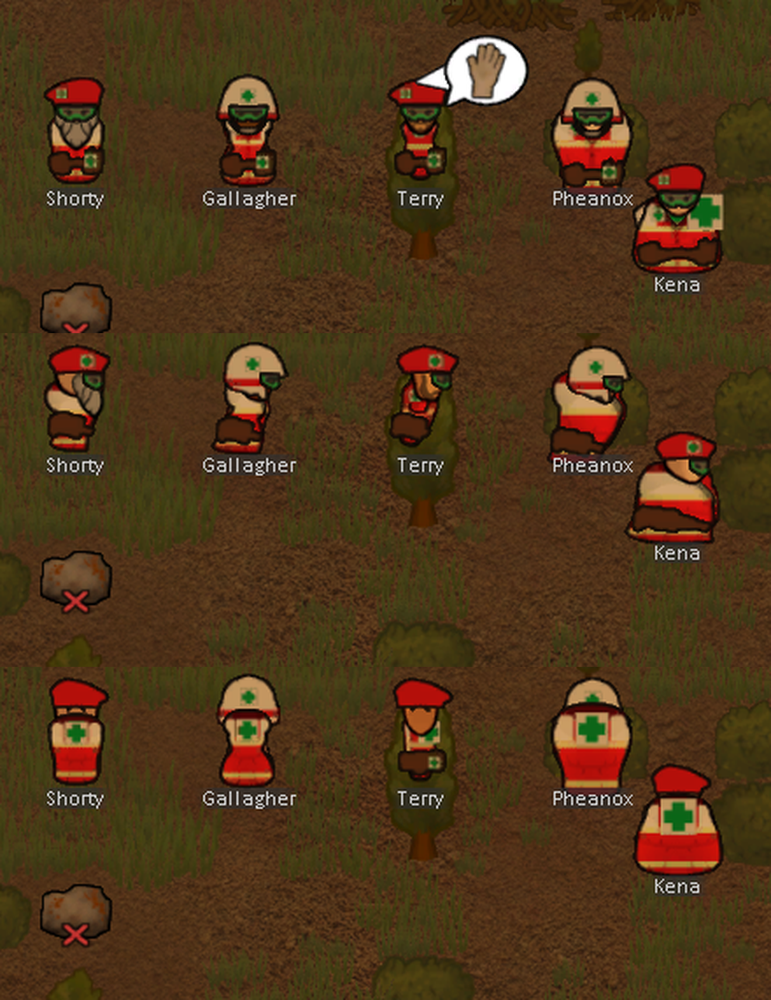

# Paramedic: Don't Die Yet! — RimWorld 1.6

Роль полевого медика через форму: надел жилет и берет (или каску) — «На смене». Лучше лечит, быстрее спасает,
кричит «Медик! Не стрелять!» — и поклялся не убивать: вред человеку своими руками бьёт по настроению.



- 8 вещей формы на всех слоях, 3 исследования, шприц адреналина
- 3 способности, клятва и кризис веры, звания, выгорание, гуманитарная помощь
- EN + RU, настройки мода; требует Harmony; несовместим с Combat Extended

## Документы
- [docs/DESIGN.md](docs/DESIGN.md) — механики и числа (как реализовано)
- [docs/COMPAT.md](docs/COMPAT.md) — патчи и проверенная совместимость (DutyOptim, CAI 5000)
- [docs/TESTING.md](docs/TESTING.md) — автотест в игре, снимки, генерация текстур
- [docs/QUESTIONS.md](docs/QUESTIONS.md) — решения и открытые вопросы
- [docs/PLAN.md](docs/PLAN.md) — план работ v1.0
- [CHANGELOG.md](CHANGELOG.md)

## Сборка
```
dotnet build Source/Paramedic.csproj -c Release
```
DLL → `Assemblies/Paramedic.dll` (игра должна быть закрыта). Мод подключён к игре ссылкой
`RimWorld/Mods/Paramedic` → эта папка.

## Авторство ресурсов
Текстуры формы сгенерированы `tools/gen_textures.py`: силуэт и объём взяты из одежды мода
[RH2] Rimmu-Nation² – Clothing (мастерская 2563506048), цвет и нашивки — свои. Иконки способностей, шприц,
штаны, превью — нарисованы с нуля. **Перед публикацией в Steam силуэты RH2 заменить своими.**
